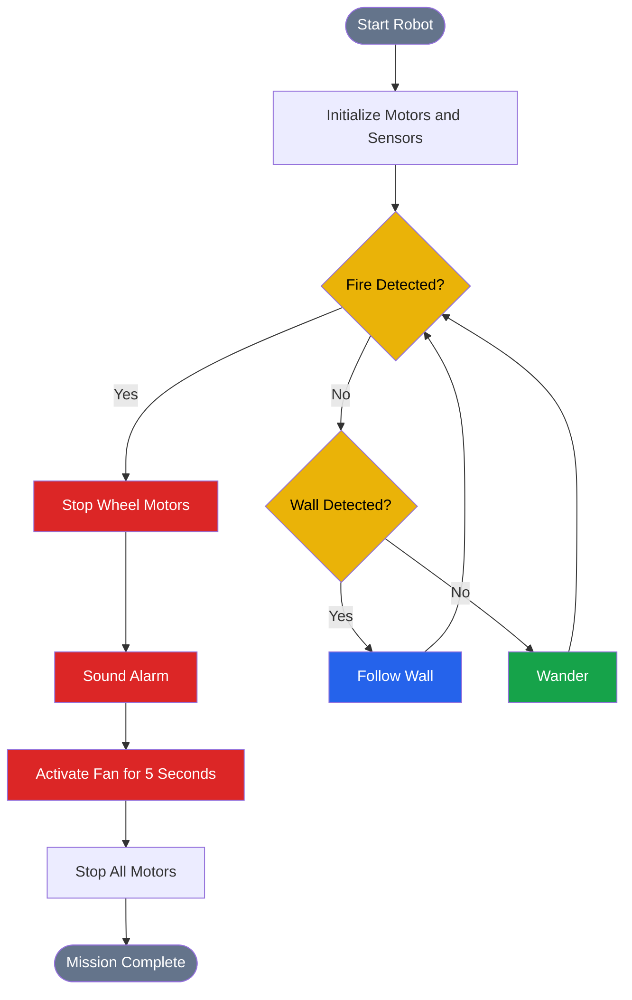

# Fire Defender Robot

## Project Overview

The Fire Defender Robot is an autonomous LEGO Mindstorms EV3
robot programmed using Python and Pybricks MicroPython.

The robot navigates its environment through wandering and
wall following, detects a simulated fire target, sounds an
audible alarm, and activates a motor-powered fan to attempt
to extinguish a candle.

## Project Objectives

- Navigate autonomously through an environment.
- Detect and follow walls.
- Navigate corners and avoid getting stuck.
- Wander through open spaces.
- Detect a fire target using a color sensor.
- Sound an audible alarm when a target is detected.
- Activate a fan to extinguish a candle.

## Robot Behavior Diagram



## Project Structure

```text
fire-defender/
├── main.py
├── config.py
├── drive.py
├── follow_wall.py
├── room_search.py
├── fire_detection.py
└── README.md
```

| File | Description |
| --- | --- |
| `main.py` | Wandering and overall behavior coordination |
| `config.py` | Shared robot configuration and constants |
| `drive.py` | Shared movement and turning functions |
| `follow_wall.py` | Wall detection and wall following |
| `room_search.py` | Bumper-based room survey and systematic coverage |
| `fire_detection.py` | Fire detection, alarm, and extinguishing |
| `README.md` | Project documentation |

## Team Responsibilities

### Person 1: Robot Construction and Wall Following

**Assigned file:** `follow_wall.py`

Responsibilities:

- Build and configure the robot.
- Configure sensors and motors.
- Program wall detection and wall following.
- Handle corners and prevent the robot from getting stuck.

Deliverables:

- `detect_wall()`
- `follow_wall()`
- A working robot capable of navigating along walls.

### Person 2: Wandering and Behavior Coordination

**Assigned file:** `main.py`

Responsibilities:

- Program the robot to move through open spaces.
- Determine when to switch between wandering and wall following.
- Combine all team members' functions into one main program.
- Prioritize fire detection over navigation.

Deliverables:

- `wander()`
- `main()`
- A working program that coordinates all robot behaviors.

### Person 3: Fire Detection, Alarm, and Extinguishing

**Assigned file:** `fire_detection.py`

Responsibilities:

- Program the robot to identify a simulated fire target.
- Program an audible alarm.
- Build and program the fan using a third motor.
- Test whether the fan can extinguish a candle.

Deliverables:

- `detect_fire()`
- `alarm()`
- `extinguish(left, right)`
- `stop_fan()`

## Hardware Configuration

| Component | Port | Purpose |
| --- | --- | --- |
| Left Wheel Motor | B | Robot movement |
| Right Wheel Motor | C | Robot movement |
| Fan Motor | A | Fire extinguishing |
| Front Touch Sensor | S1 | Front bumper for wall and corner detection |
| Right Touch Sensor | S2 | Right-side bumper for tracking walls |
| Color Sensor | S3 | Fire target detection |
| Gyro Sensor | S4 | Heading and turning |

Mount the bumpers so they press the touch sensors before the robot chassis
hits a wall. The program keeps the wall on the robot's right.

## Shared Configuration

The `config.py` file contains shared constants used by the
robot's movement functions.

| Constant | Description |
| --- | --- |
| `LEFT_PORT`, `RIGHT_PORT` | Drive motor ports |
| `LEFT_DIRECTION`, `RIGHT_DIRECTION` | Positive rotation for each drive motor |
| `SPEED` | Default motor speed |
| `STRAIGHT_KP` | Gyro correction gain for straight travel |
| `WHEEL_DIAMETER` | Wheel diameter in millimeters |
| `AXLE_TRACK` | Distance between wheels in millimeters |
| `SEARCH_TIMEOUT_MS` | Search duration, initially 180000 milliseconds |

## Shared Drive Functions

All team members should use `drive.py` for robot movement
instead of implementing separate motor controls.

```python
import drive
```

### Drive Function Reference

| Function | Description |
| --- | --- |
| `straight(left, right, distance)` | Drive a specified distance in millimeters |
| `move_wheels(left, right, left_angle, right_angle)` | Rotate each wheel independently |
| `turn(left, right, angle)` | Turn using gyro feedback |
| `stop(left, right)` | Brake both wheel motors |

### Example Usage

```python
import drive

# Move forward 200 mm
drive.straight(left, right, 200)

# Move backward 100 mm
drive.straight(left, right, -100)

# Turn left 90 degrees
drive.turn(left, right, 90)

# Turn right 90 degrees
drive.turn(left, right, -90)

# Stop the robot
drive.stop(left, right)
```

### Movement Conventions

- Positive distances move the robot forward.
- Negative distances move the robot backward.
- Positive turning angles rotate counterclockwise.
- Negative turning angles rotate clockwise.
- Distances are measured in millimeters.
- Angles are measured in degrees.

## Fire Detection Functions

The `fire_detection.py` module handles target detection,
audible alerts, and fan activation.

```python
import fire_detection as fire
```

| Function | Description |
| --- | --- |
| `detect_fire()` | Reads whether the floor matches `TARGET_COLOR` |
| `TargetMonitor.sample()` | Confirms the target color across repeated readings and remembers the detection |
| `alarm()` | Plays an audible alarm |
| `extinguish(left, right)` | Activates the fan for the configured duration |
| `stop_fan()` | Stops the fan motor |

### Fan Configuration

| Setting | Value |
| --- | --- |
| Fan Motor Port | A |
| Fan Speed | 1000 degrees per second |
| Fan Duration | 5000 milliseconds |
| `TARGET_COLOR` | `Color.RED` |
| `TARGET_CONFIRMATION_MS` | 40 milliseconds |

### Example Usage

```python
target = fire.TargetMonitor()  # Keep one instance and call sample during movement.
if target.sample():
    drive.stop(left, right)
    fire.alarm()
    fire.extinguish(left, right)
```

## Main Program

The main program coordinates all robot behaviors.

### Behavior Priority

1. Fire detection and extinguishing
2. Room survey and floor sweeps
3. Wall following and wandering when the survey ends or cannot estimate a room

Run [main.py](main.py) on the EV3. The robot uses two parallel approaches
to estimate the direction of a wall. It then measures clear travel along
both room axes with its wheel encoders and gyro. It sweeps the middle and
quarter lanes first to check for open passages, then scans between those
lanes. Bumper contact stops a sweep. If the survey ends without a target,
the robot resumes wall following and wandering. The controller checks for
the target before and during motion.

If drive feedback stops progressing, the robot holds the wheels, realigns,
and tries backing away and turning. If it cannot retreat or turn within
the recovery sequence, it displays `Path blocked`. If the search reaches
its deadline, the robot stops and displays `Search timed out`.

## Integration Guidelines

- Each team member should work in their assigned file.
- Use `drive.py` for shared movement functions.
- Use `config.py` for shared configuration values.
- Do not initialize the same motor or sensor in multiple files.
- Only `main.py` should contain the main behavior loop.
- Navigation functions should perform short movement steps
  before returning control to the main program.
- Detection functions should return boolean values.
- Motors should stop safely when an error occurs.
- Communicate changes to shared functions before merging.

## Git Collaboration

Each team member should work on their own branch.

| Team Member | Branch |
| --- | --- |
| Person 1 | `wall-following` |
| Person 2 | `wandering-coordination` |
| Person 3 | `fire-detection` |

### Create a Branch

```bash
git switch -c your-branch-name
```

### Save Changes

```bash
git add .
git commit -m "Describe your changes"
git push -u origin your-branch-name
```

### Update Your Local Main Branch

```bash
git switch main
git pull origin main
```

Team members should submit pull requests to merge their
completed work into the main branch.

## Testing Checklist

To run a standalone movement check on the EV3, set `TEST` in
[tests/test.py](tests/test.py) to `directions`, `straight`, `turn`, or
`square`. The `gyro` and `gyro_turn` modes display sensor readings.

From the project directory, run `python3 tests/simulate_coverage.py` to
reproduce the 80-trial search benchmark on a computer. Add `--holdout` to
also run cases with different starting poses, doorway and target positions.

### Robot Construction and Movement

- [ ] Robot construction completed
- [ ] Motor and sensor ports configured
- [ ] Straight movement tested
- [ ] Gyro-based turning tested
- [ ] Individual wheel movement tested
- [ ] Motor stopping tested

### Wall Following

- [x] Wall detection implemented
- [x] Wall following implemented
- [ ] Corner navigation tested
- [ ] Obstacle avoidance tested
- [ ] Robot can recover from difficult positions

### Wandering and Coordination

- [x] Wandering implemented
- [ ] Wandering-to-wall-following transition tested
- [ ] Wall-following-to-wandering transition tested
- [x] Main behavior loop implemented
- [ ] Fire detection correctly prioritized

### Fire Detection and Extinguishing

- [ ] Red target detection tested
- [ ] Audible alarm tested
- [ ] Fan motor tested
- [ ] Fan successfully extinguishes a candle
- [ ] All motors stop after an extinguishing attempt

### Final Integration

- [ ] All team branches merged
- [ ] All modules work together
- [ ] Complete autonomous navigation tested from different starting positions and headings
- [ ] Complete fire response tested
- [ ] Final demonstration completed

## Current Limitations

- Any floor surface matching the configured target color for the
  confirmation interval can trigger the fire response.
- The robot does not independently verify whether a fire has
  been extinguished.
- Stall recovery relies on wheel encoders and gyro feedback. Bumper
  coverage and clearance affect which obstacles the robot can recover from.
- The survey estimates perpendicular room axes from contact points. Curved
  walls, contact with different walls, and wheel slip can skew the estimated
  sweep lanes.
- The robot is an educational prototype and is not intended
  for real-world firefighting.

All candle extinguishing tests should be conducted in a
controlled and supervised environment.

## Technologies Used

- LEGO Mindstorms EV3
- Python
- Pybricks MicroPython
- Git
- GitHub
- Mermaid
